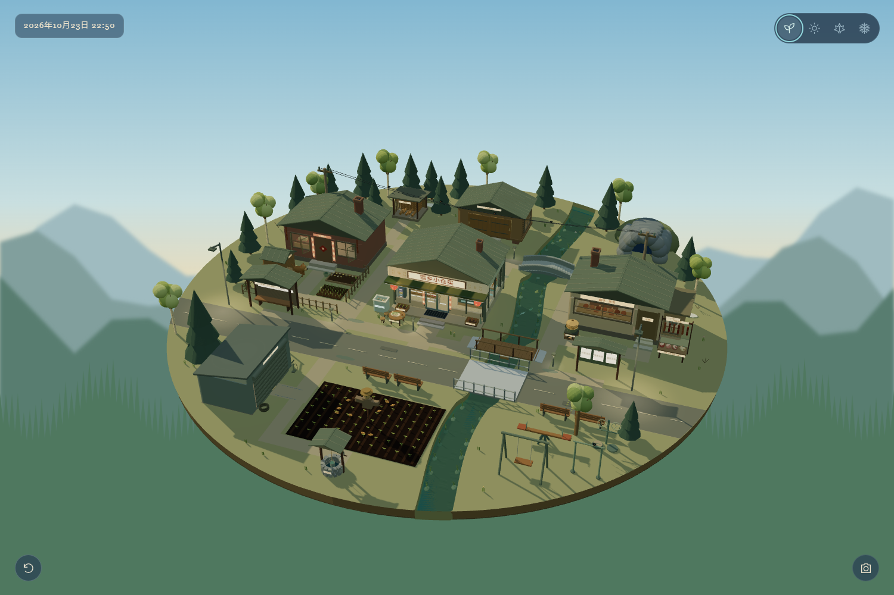
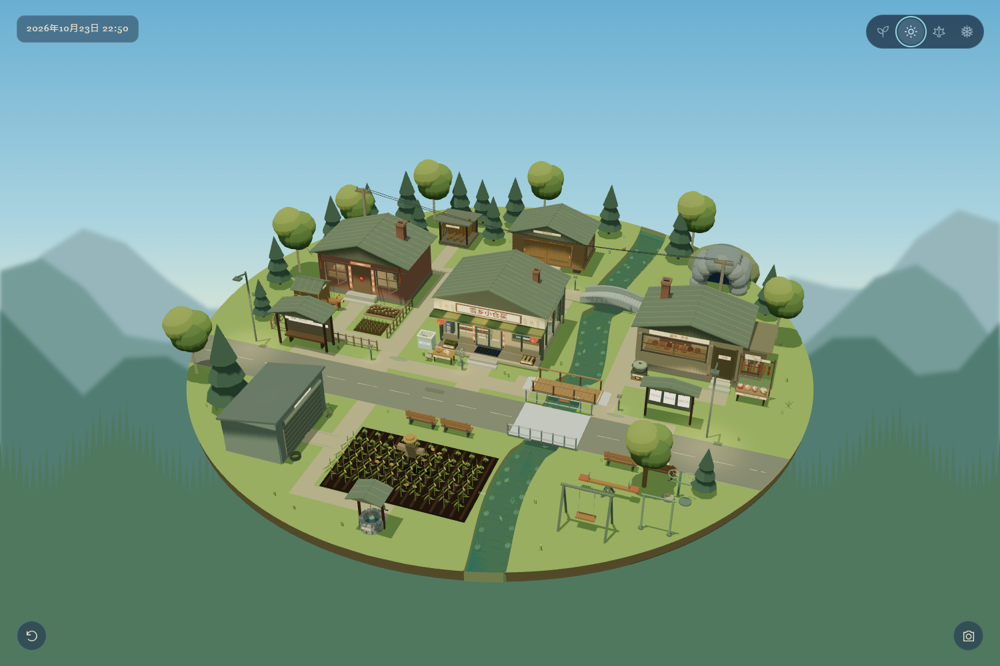
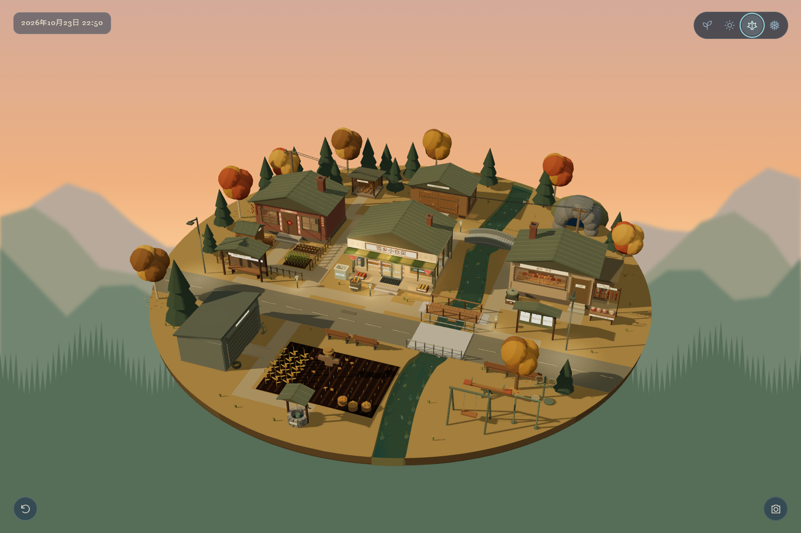
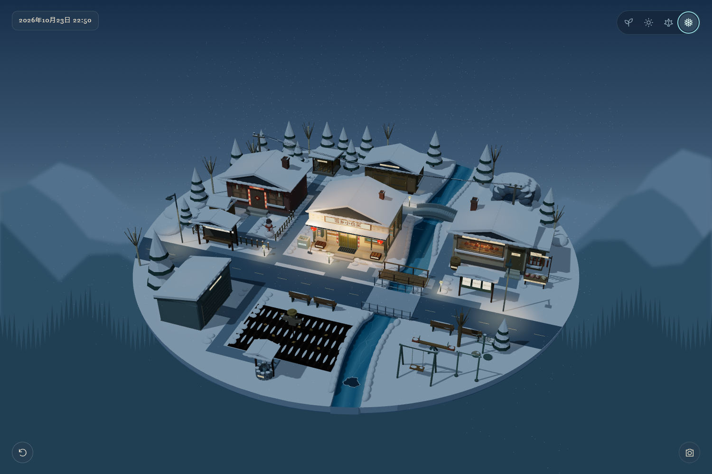

# 雪乡小仓买 · 四季村庄

一座被大山和森林环绕的东北小镇。沿着熟悉的路，在春日清晨、夏日正午、橙色秋暮与冬季蓝调之间切换，看看同一个家乡在四季里的日常。

[在线体验](https://wfcsilence.github.io/snow-village-seasons/) · [下载正常网页版 ZIP](https://github.com/wfcsilence/snow-village-seasons/releases/latest/download/snow-village-seasons-web.zip) · [迭代记录](迭代记录.md)

| 春 · 日出后的清晨 | 夏 · 正午 |
| --- | --- |
|  |  |
| 秋 · 橙色晚霞 | 冬 · 蓝调时刻 |
|  |  |

## 同一座村庄，四种生活

建筑、道路、主要树木和背景山林的轮廓四季对应。便利店、炕房、熟食店、粮仓、修车棚与柴火棚各有用途，三座桥连接两岸。大妈从家里出门，依次到熟食店、便利店购物后回家；大爷乘班车来，去粮仓办事、回家，再乘车离开。

- **春晨**：嫩叶、返青小葱、窗下春花与流动的薄冰。圆桌上摆着蘸酱菜，两个小圆凳留在桌边，门前筐里是婆婆丁和香椿芽；水壶放在花圃旁，熟食店的竹蒸笼里叠着薄薄的春饼。
- **夏午**：浓绿树荫、瓜果菜地、西瓜桌、马扎与旧风扇。熟食店门前煮毛豆花生，三只麻雀疏密不一地停在电线上，河里有四种鱼游动、浮水。
- **秋暮**：橙色晚霞、收割田、晾玉米、较高的大葱与窗下秋菊。黄叶在风里翻转飘落，两只斑鸠缓缓张望；敞口炉同时烤苞米和地瓜，持续飘浅浅白气，熟食店门前煮着黏苞米。
- **冬季**：冷蓝山林、雪花、炊烟、冰河与暖灯。脚印和浅车辙慢慢被雪覆盖，熟食店门前是带木盖的酸菜缸。

便利店后排早餐柜四季统一保留冬季陈列，横幅为「包子、烧饼、油条新上市」。

## 观看与互动

右上角四个图标依次切换春、夏、秋、冬；拖动旋转，滚轮或双指缩放，双击聚焦。左下角重置，M 键静音，右下角预览、下载明信片；首次操作后启用声音。手机会显示横屏引导。

花圃水壶、春饼蒸笼、夏秋鸟类、秋日叶堆、酸菜缸盖、冰柜、熊洞、稻草人、水井、窗户和活动器材都能回应点击。公告栏可以读信、写私人留言，留言仅保存在访问者本地。

根目录 `index.html` 是正常网页版，资源均随项目内置，无需安装依赖。解压后可用支持 WebGL 的现代浏览器直接打开。详见[使用说明](使用说明.md)与[第三方许可](THIRD_PARTY_NOTICES.md)。

## 版本与检查

**v1.1.0** 在此前冬夏版本及多轮迭代成果上加入春秋，完成四季日照、背景统一、季节食物、桌凳与鸟类差异，并移除春冬背景中的白色三角形。

本项目在独立建仓前已迭代多轮；v1.0.0 表示独立仓库首次发布，不是雪乡场景初版。[完整迭代记录](迭代记录.md)按实际推进顺序回顾这些阶段。

已在桌面、手机横竖屏的浏览器尺寸下检查四季切换、主要互动、鸟类飞行归位、人物路线与明信片保存；不等同于所有移动设备的真机验证。
